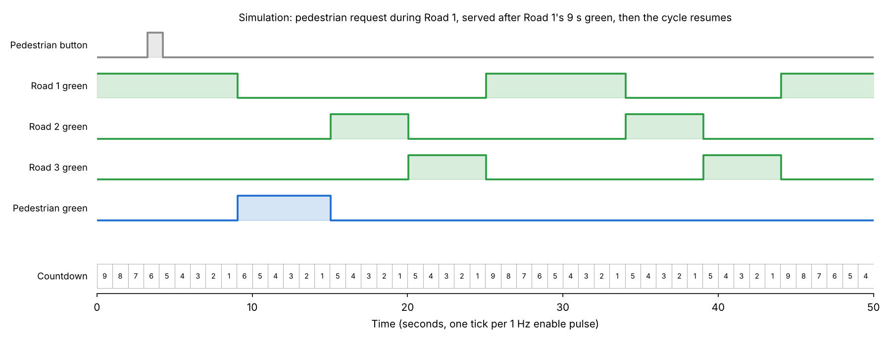
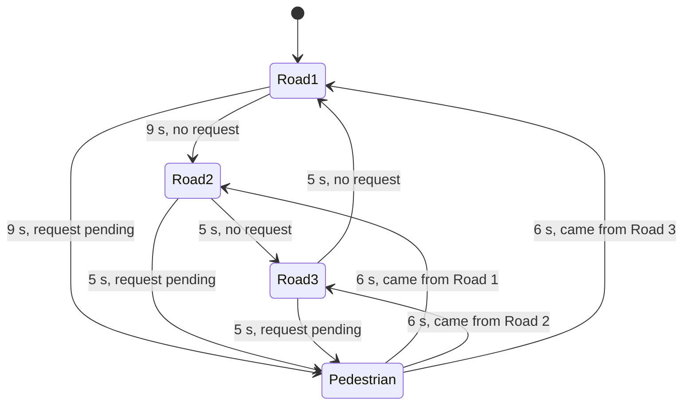

# Smart Pedestrian Crossing System (FPGA)

A three-road traffic light controller with a pedestrian crossing, written in **Verilog** and running on a **Nexys A7 (Artix-7) FPGA** board. A finite state machine cycles the three roads with priority timing, serves pedestrian requests with a dedicated crossing phase, and shows a live countdown for every phase on the board's seven-segment displays.

Built with [Qais Abu Adas](https://github.com/TheHyperDonut) for the Digital Logic Design Lab (COE 203) at KFUPM, Fall 2025.



*Simulation of the controller: a pedestrian presses the button during Road 1's green. The request is held until Road 1 finishes its 9 s, the pedestrian gets a 6 s crossing phase, and the normal cycle resumes with Road 2.*

## Features

- **Four-state finite state machine:** Road 1, Road 2, Road 3, and Pedestrian
- **Priority timing:** Road 1 (the main road) gets 9 s of green, Roads 2 and 3 get 5 s each, and the pedestrian phase lasts 6 s
- **Pedestrian requests are queued, not immediate:** a button press is remembered, the current road finishes its full green, and only then does the crossing phase start
- **Resumes where it left off:** after the crossing phase, the cycle continues with the road that comes next in the sequence
- **Exact 1 Hz timing:** a counter on the 100 MHz board clock generates a one-cycle enable pulse every second, so the whole design stays synchronous to a single clock
- **Live countdown** for each phase on its own seven-segment digit
- **Red and green LEDs** for each road and for the pedestrian crossing
- **Reset button** and an **enable switch** that pauses the whole system
- **Small footprint:** 104 LUTs and 79 registers, about 1% of the Artix-7 100T

## Board I/O (Nexys A7-100T)

| Signal | Board control | Pin |
|---|---|---|
| 100 MHz clock | Onboard oscillator | E3 |
| Enable (run / pause) | Switch SW0 | J15 |
| Reset | Button BTNU | M18 |
| Pedestrian request | Button BTND | P18 |
| Road 1 green / red | LED LD0 / LD1 | H17 / K15 |
| Road 2 green / red | LED LD4 / LD5 | R18 / V17 |
| Road 3 green / red | LED LD8 / LD9 | V16 / T15 |
| Pedestrian green / red | LED LD12 / LD13 | V15 / V14 |
| Countdowns | Seven-segment digits 0, 2, 4, 6 (Road 1, Road 2, Road 3, Pedestrian) | see `constraints/nexys_a7.ucf` |

## How it works

### State machine



Each state loads its duration into a 4-bit countdown timer. The timer decrements once per second, and when it reaches the end of the phase, the FSM moves to the next state. If a pedestrian request is pending at that moment, the FSM goes to the pedestrian state instead and remembers which road it came from, so it can continue the sequence afterwards.

### Timing

The board runs at 100 MHz. Rather than creating a slow 1 Hz clock, `onehz.v` counts 100,000,000 cycles and outputs a pulse that's high for a single cycle. The state machine runs on the 100 MHz clock and only advances when that pulse is present. Keeping everything on one clock avoids the timing problems that come with derived clocks on an FPGA.

### Pedestrian button

The button sets a flip-flop (`dff.v`) that holds the request until the next one-second tick, so even a quick press is never missed. The state machine then latches it as a pending request until the crossing phase has been served.

### Display

`DISP7SEG.v`, a display driver provided in the COE 203 course materials, drives the board's eight-digit seven-segment display by time-multiplexing: it switches to the next digit every 25 µs, fast enough that all digits appear lit at once. Each phase's remaining time shows on its own digit.

## Modules

| File | Module | Purpose |
|---|---|---|
| `src/Main.v` | `trafficWithPed` | Top level: connects the clock divider, button logic, FSM, display, and LEDs |
| `src/traffic.v` | `traffic` | The traffic light finite state machine and countdown timer |
| `src/onehz.v` | `onehz` | Generates the one-cycle, 1 Hz enable pulse from the 100 MHz clock |
| `src/dff.v` | `dff` | Flip-flop that holds a pedestrian button press until the next tick |
| `src/DISP7SEG.v` | `DISP7SEG` | Time-multiplexed driver for the eight-digit seven-segment display (provided in the COE 203 course materials) |

## Simulation

`sim/tb_traffic.v` is a testbench for the state machine. It speeds time up so one simulated second is 10 clock cycles, presses the pedestrian button during Road 1, and records the result to a waveform file. The diagram at the top of this page comes from that run.

To run it with Icarus Verilog:

```
iverilog -o tb sim/tb_traffic.v src/traffic.v
vvp tb
```

Then open `traffic.vcd` in any waveform viewer, such as GTKWave.

## Building and running on the board

The project was built with **Xilinx ISE 14.7** for the **Nexys A7-100T** (`xc7a100t-3csg324`).

**To program the board directly:** load `bitstream/trafficwithped.bit` onto the Nexys A7 using iMPACT or the Vivado Hardware Manager.

**To rebuild from source:**
1. Create a new ISE project for device `xc7a100t-3csg324`.
2. Add every file in `src/` and set `trafficWithPed` (in `Main.v`) as the top module.
3. Add `constraints/nexys_a7.ucf`.
4. Run synthesis, implementation, and **Generate Programming File**.

**On the board:** turn on SW0 to start the system. Press BTND to request a pedestrian crossing, and BTNU to reset.

## Files

| Path | Description |
|---|---|
| `src/` | Verilog source for all modules |
| `constraints/nexys_a7.ucf` | Pin assignments for the Nexys A7 |
| `sim/tb_traffic.v` | Testbench for the state machine |
| `bitstream/trafficwithped.bit` | Ready-to-load bitstream for the Nexys A7-100T |
| `docs/waveform.png` | Simulation timing diagram |
